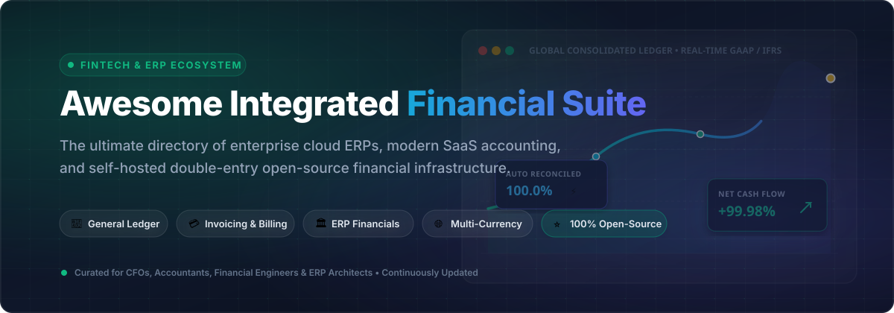

# 💼 Awesome Integrated Financial Suite

  

  
  
  
  
  
  

---

## 🧭 Executive Summary & SEO Overview

> **A curated showcase of premier enterprise SaaS platforms and self-hosted open-source GitHub projects for Integrated Financial Suites, Cloud Accounting, General Ledger, ERP Financials, Billing, and Treasury Infrastructure.**

Whether you are a **CFO**, **Financial Controller**, **Chartered Accountant**, **FinTech Founder**, or **Software Engineer**, selecting the optimal accounting and financial architecture is critical for compliance, scalability, auditability, and liquidity operations. 

This repository consolidates the financial engineering landscape:
- 🏛️ **Enterprise SaaS Financial Suites** (Tier-1 Cloud ERPs, Consolidation, Automated Workflows)
- 💻 **Open-Source Double-Entry Ledgers** (Self-hosted sovereign accounting, Plain-text systems, Micro-business ERPs)
- 💳 **Billing, Metering & Payment Engines** (Subscription lifecycles, API-first invoicing, Usage-based billing)
- 🌐 **Global Compliance** (GAAP, IFRS, Multi-Currency, Multi-Entity, Tax Engines & e-Invoicing)

---

## 📊 Sector Overview & Market Dynamics

The global **Financial Management Software (FMS) and Integrated Accounting Suite** market is estimated at approximately **$14.5 Billion to $18.2 Billion**, expanding at a compound annual growth rate (**CAGR**) of **8.5% to 10.8%** and projected to exceed **$35 Billion to $45 Billion** over the next decade.

The sector demonstrates **moderate-to-high concentration at the mega-enterprise tier** (dominated by entrenched enterprise ERP giants like Microsoft, Oracle NetSuite, and SAP), while exhibiting **high fragmentation across the mid-market, SMB, and specialized developer ecosystem**. In mid-market and SMB domains, modern SaaS challengers (Intuit QuickBooks, Xero, Sage, Zoho) compete fiercely with an explosive wave of API-first billing platforms and sovereign, self-hosted open-source financial solutions (ERPNext, Odoo Community, Lago, Kill Bill, Firefly III).

---

## 📑 Table of Contents

- [📊 Sector Overview & Market Dynamics](#-sector-overview--market-dynamics)
- [☁️ SaaS / Hosted Platforms](#️-saas--hosted-platforms)
- [🔓 Open-Source GitHub Projects](#-open-source-github-projects)
- [🛠️ Architectural Blueprints & Stacks](#️-architectural-blueprints--stacks)
- [🤝 How to Contribute](#-how-to-contribute)
- [💖 Support & Sponsorship](#-support--sponsorship)
- [📈 Star History](#-star-history)
- [⚖️ Disclaimer](#️-disclaimer)

---

## ☁️ SaaS / Hosted Platforms

Below are leading enterprise and mid-market SaaS financial suites, sorted in descending order by parent company scale (Market Capitalization for public entities or Enterprise Valuation for private firms).

| Product | Company Scale (Market Cap / Valuation / Revenue) | Description | Pricing (Starting Tier) | Free Tier / Trial Limits |
| :--- | :--- | :--- | :--- | :--- |
| **[Microsoft Dynamics 365 Finance](https://microsoft.com)** | **~$3.76T Market Cap** *(~$331.8B Annual Revenue)* | Cloud financial operations platform delivering automated global accounting, budgeting, cash flow forecasting, and regulatory compliance. | $210/user/month (first qualifying Dynamics 365 app, billed annually) | 30-day free trial with access to preloaded sample financial data and workflows (work email required); no permanent free tier. |
| **[Oracle NetSuite ERP](https://netsuite.com)** | **~$365B Market Cap** *(~$55B Annual Revenue)* | Comprehensive cloud ERP and financial management platform offering general ledger, revenue recognition, tax management, and global consolidation. | $999/month base platform fee + $125–$199/user/month (annual contract) | 3-day self-service test drive (sample data); up to 14–30 day partner-led evaluation sandboxes upon qualification. No permanent free tier. |
| **[SAP S/4HANA Cloud](https://sap.com)** | **~$270B Market Cap** *(~$45B Annual Revenue)* | Enterprise-grade intelligent ERP suite providing real-time financial accounting, treasury management, risk compliance, and predictive analytics. | ~$180–$200/user/month (Public Edition baseline, annual enterprise contract) | 30-day free trial (Cloud Public Edition shared-tenant sandbox preloaded with sample enterprise finance processes); no permanent free tier. |
| **[QuickBooks Enterprise](https://intuit.com)** | **~$95B Market Cap** (Intuit) *(~$21.4B Annual Revenue)* | Full-featured business accounting and financial management solution supporting advanced inventory, job costing, payroll, and custom reporting. | $1,700/year (Silver Plan, 1 user, billed annually) | 30-day free trial with full functional access (no credit card required, test with own data); no permanent free tier. |
| **[Workday Financial Management](https://workday.com)** | **~$47B Market Cap** *(~$8.5B Annual Revenue)* | Enterprise cloud finance suite unifying accounting, procurement, project financials, and workforce planning in a single data core. | ~$5,000/month baseline (custom annual enterprise contracts) | 30-day free trial available for Workday Adaptive Planning; core Financial Management offers guided live demos and contract-based PoC evaluation environments only. No permanent free tier. |
| **[Xero](https://xero.com)** | **~$15B Market Cap** *(~$1.4B Annual Revenue)* | Cloud-based accounting software tailored for small and medium businesses with automated bank feeds, invoicing, payroll, and multi-currency support. | $27/month (Early plan, US pricing; allows unlimited users) | 30-day free trial with full access. On Early paid tier: capped at 20 invoices/quotes per month and 5 bills per month. No permanent free tier. |
| **[Sage Intacct](https://sage.com)** | **~$13B Market Cap** (The Sage Group) *(~$3.2B Annual Revenue)* | AICPA-preferred cloud financial management system featuring multi-entity consolidation, dimensional reporting, and automated AP/AR workflows. | ~$11,000–$12,000/year (Core Financials module for single business user) | 30-day trial sandbox via certified partners/sales (preloaded sample company data, temporary environment deleted after 30 days); no permanent free tier. |
| **[Acumatica Cloud ERP](https://acumatica.com)** | **~$2.0B Valuation** *(Private Equity-backed)* | Adaptable mid-market cloud ERP offering multi-company accounting, deferred revenue tracking, cash management, and inter-company transfers. | ~$1,500/month (~$18,000/year base tier, includes unlimited users, billed based on transaction volume/resources) | 14-day free trial sandbox provisioned via certified partners (capped at 2 concurrent users, 4 CPU cores, and sample company dataset); no permanent free tier. |
| **[Zoho Finance Plus](https://zoho.com)** | **~$1.5B Annual Revenue** *(Private / Bootstrapped)* | Unified cloud financial suite combining accounting (Zoho Books), invoicing, subscription billing, expense management, and inventory tracking. | $249/organization/month (billed annually) or $299/month (includes 10 users) | 14-day free trial with full access to all apps (Zoho Books, Expense, Inventory, Billing); no permanent free tier. |
| **[Certinia (formerly FinancialForce)](https://certinia.com)** | **~$1.0B Valuation** *(Acquired by Haveli / PE-backed)* | Salesforce-native ERP and financial management platform connecting professional services automation (PSA) directly with billing and accounting. | ~$150/user/month for Financial Management module (plus underlying Salesforce licensing, billed annually) | Managed proof-of-concept / sandbox evaluation arranged through sales & partners (tied to Salesforce org/sandbox); no self-service permanent free tier. |

---

## 🔓 Open-Source GitHub Projects

All open-source financial platforms, accounting ledgers, and billing engines are ordered strictly in **descending order by GitHub Stars_Count**. Each repository badge links directly to its stargazer community.

- **[Odoo Community](https://github.com/odoo/odoo)**   
  Modular open-source ERP suite offering comprehensive invoicing, double-entry bookkeeping, expense tracking, and multi-company financial operations.

- **[Maybe](https://github.com/maybe-finance/maybe)**   
  Modern, self-hosted personal finance, wealth tracking, and portfolio accounting engine written in Ruby on Rails.

- **[Hyperswitch (by Juspay)](https://github.com/juspay/hyperswitch)**   
  High-performance open-source financial payment orchestration, smart routing, and global settlement reconciliation written in Rust.

- **[ERPNext (Frappe)](https://github.com/frappe/erpnext)**   
  Flagship open-source ERP and integrated accounting suite built on the Frappe framework, featuring real-time double-entry accounting, multi-currency, asset depreciation, and tax engines.

- **[Actual Budget](https://github.com/actualbudget/actual)**   
  Local-first, privacy-focused open-source personal and household envelope budgeting suite with end-to-end encryption, multi-device sync, and bank statement importing.

- **[Firefly III](https://github.com/firefly-iii/firefly-iii)**   
  Self-hosted financial manager and ledger for individuals and micro-businesses featuring double-entry bookkeeping, budget enforcement, and automated rule engines.

- **[Snipe-IT](https://github.com/grokability/snipe-it)**   
  Premier open-source asset management system for tracking asset depreciation, financial valuation, audit trails, and hardware/software licenses.

- **[Lago](https://github.com/getlago/lago)**   
  Open-source metering and usage-based billing API engine, serving as a self-hosted developer alternative to Stripe Billing and Chargebee.

- **[Invoice Ninja](https://github.com/invoiceninja/invoiceninja)**   
  Leading open-source invoicing, expense tracking, and time-billing platform supporting dozens of payment gateways, recurring subscriptions, and client portals.

- **[Akaunting](https://github.com/akaunting/akaunting)**   
  Online accounting software built on Laravel for small businesses and freelancers, providing invoicing, bill management, bank synchronization, and app-store extensions.

- **[Grocy](https://github.com/grocy/grocy)**   
  Web-based self-hosted enterprise resource planning (ERP) system for micro-businesses and households, handling stock valuation, consumption tracking, and purchase expenses.

- **[Crater](https://github.com/crater-invoice-inc/crater)**   
  Self-hosted invoicing and expense management web and mobile suite designed for freelancers and small businesses with custom PDF invoice generation.

- **[Dolibarr ERP & CRM](https://github.com/Dolibarr/dolibarr)**   
  All-in-one open-source ERP and CRM web suite providing double-entry accounting, bank reconciliation, VAT/tax reporting, and billing modules.

- **[Beancount](https://github.com/beancount/beancount)**   
  Command-line double-entry bookkeeping language and Python toolset enabling programmatic financial verification, transaction assertions, and ledger analysis.

- **[Ledger CLI](https://github.com/ledger/ledger)**   
  Pioneering plain-text double-entry accounting system with ultra-fast command-line balance sheets, register reporting, and multi-currency valuation.

- **[Kill Bill](https://github.com/killbill/killbill)**   
  Enterprise-grade open-source subscription billing, payment routing, and financial analytics platform engineered for complex recurring revenue pipelines.

- **[Frappe Books](https://github.com/frappe/books)**   
  Free, offline-first desktop double-entry bookkeeping application tailored for small businesses and freelancers, requiring no cloud account.

- **[Hledger](https://github.com/hledgerorg/hledger)**   
  Robust, cross-platform plain-text accounting suite written in Haskell, providing CLI, TUI, and local web interfaces for strict double-entry ledger audits.

- **[GnuCash](https://github.com/Gnucash/gnucash)**   
  Cross-platform open-source personal and small-business financial accounting software implementing professional double-entry principles, bank reconciliation, and QIF/OFX imports.

- **[Bigcapital](https://github.com/bigcapitalhq/bigcapital)**   
  Modern open-source financial accounting and core bookkeeping platform built for real-time reporting, automated cash flow monitoring, and multi-currency ledgers.

- **[Fava](https://github.com/beancount/fava)**   
  Sleek, responsive web interface for Beancount plain-text accounting, offering interactive balance sheets, income statements, and asset allocation graphs.

- **[Metasfresh](https://github.com/metasfresh/metasfresh)**   
  Fast, responsive open-source ERP system engineered for SMEs with integrated financial accounting, automated invoicing, and supply chain management.

- **[Apache OFBiz](https://github.com/apache/ofbiz-framework)**   
  Enterprise open-source business automation suite offering full general ledger accounting, billing accounts, customer agreements, and financial reporting.

- **[SolidInvoice](https://github.com/SolidInvoice/SolidInvoice)**   
  Simple and elegant open-source invoicing solution with client billing, automated recurring invoices, and payment gateway integrations.

- **[iDempiere](https://github.com/idempiere/idempiere)**   
  Community-powered enterprise open-source ERP, CRM, and SCM suite featuring sophisticated multi-organization, multi-accounting-schema financial engines.

- **[LedgerSMB](https://github.com/ledgersmb/LedgerSMB)**   
  Mature open-source double-entry accounting and ERP system backed by PostgreSQL, designed for strict auditability, inventory tracking, and multi-currency ledgers.

- **[Tryton](https://github.com/tryton/tryton)**   
  Modular three-tier general-purpose open-source ERP platform with modular general accounting, analytic accounting, and SEPA banking integration.

---

## 🛠️ Architectural Blueprints & Stacks

### 🏗️ Recommended Sovereign Financial Stack
For organizations building self-hosted, sovereign financial infrastructure:
- **Core General Ledger & ERP:** [ERPNext](https://github.com/frappe/erpnext) or [Odoo](https://github.com/odoo/odoo)
- **Metering & Usage Billing:** [Lago](https://github.com/getlago/lago) or [Kill Bill](https://github.com/killbill/killbill)
- **Payment Orchestration & Routing:** [Hyperswitch](https://github.com/juspay/hyperswitch)
- **Fixed Asset & IT Inventory:** [Snipe-IT](https://github.com/grokability/snipe-it)
- **Business Intelligence & Financial Analytics:** [Apache Superset](https://github.com/apache/superset) or [Metabase](https://github.com/metabase/metabase)

---

## 🤝 How to Contribute

We welcome contributions from financial engineers, developers, and accountants! 🚀
1. 🍴 **Fork the repository**.
2. 🌿 **Create a new branch**: `git checkout -b feature/new-financial-tool`.
3. ✍️ **Add or update entries**: Follow the established tabular format for SaaS or list format for Open-Source tools (including official links, specific pricing, and Stars_Count badges).
4. 📬 **Submit a Pull Request**: Provide a clear summary of the additions or updates.

⭐ Don't forget to star the repository if you find it helpful!

---

## 💖 Support & Sponsorship

If you find this curated financial suite directory valuable for your engineering, accounting, or business operations, please consider showing your support! ☕

- 🌟 **Star this repository** on GitHub to help others discover it.
- 🍴 **Fork and share** with fellow developers, CFOs, and finance professionals.
- ☕ **Sponsor or buy a coffee**: Support ongoing maintenance and curated updates via the [GitHub Sponsor Dashboard](https://github.com/sponsors/ishandutta2007).

Your support keeps this directory active, accurate, and independent! 🙌

---

## 📈 Star History

---

## ⚖️ Disclaimer

- This repository is a **community-curated collection** provided for educational and architectural reference only. It does not constitute formal financial, accounting, tax, or legal advice.
- Corporate financial implementations must strictly adhere to regional statutory standards (**GAAP**, **IFRS**) and regulatory frameworks (**SOX**, **VAT/GST**, **IRS rules**).
- Deploying self-hosted open-source financial tools requires rigorous data encryption, automated offsite database backups, immutable audit trails, and strict role-based access controls (RBAC).

---

  <b>Built for CFOs, Accountants, Financial Engineers &amp; ERP Architects worldwide.</b> 
  Making corporate finance and accounting infrastructure transparent, sovereign, and accessible.

